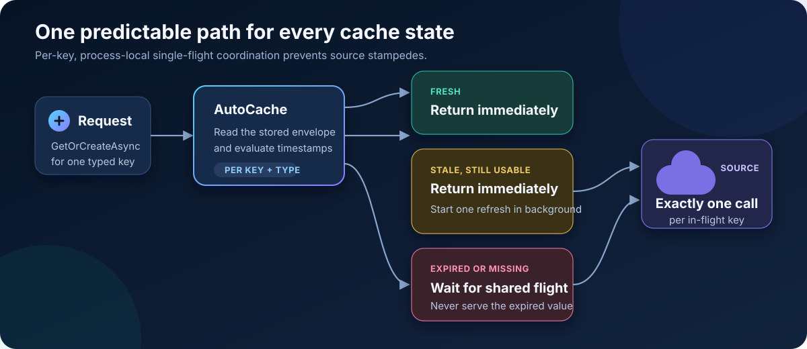

# AutoCache

[](https://www.nuget.org/packages/AutoCache)
[](https://www.nuget.org/packages/AutoCache)
[](https://github.com/n-yousefi/AutoCache/actions/workflows/ci.yml)
[](https://dotnet.microsoft.com/)
[](src/AutoCache/AutoCache.csproj)

**Predictable stale-while-revalidate caching and per-key single-flight coordination for high-throughput .NET applications.**

AutoCache wraps the storage backend you already use. It prevents a cold cache miss from becoming a source stampede, returns stale data without waiting while one refresh runs, and stops serving data at its hard-expiration boundary.

- One source call for a concurrent cold miss or stale refresh
- Immediate stale responses during background revalidation
- Caller cancellation that does not abort work shared by other callers
- Source deadlines, refresh-failure backoff, and optional refresh jitter
- Removable per-key flight state with bounded outage tracking
- `System.Diagnostics.Metrics` and `ActivitySource` instrumentation
- No runtime NuGet dependencies
- Source Link metadata and a NuGet symbol package for debugging
- .NET 8 and .NET 10 support

> AutoCache coordinates work inside one adapter instance and one process. Storage, serialization, distributed locking, and cache topology stay under application control.

## Install

Install the stable Version 4 package:

```bash
dotnet add package AutoCache --version 4.0.0
```

## How it works



Each stored value is wrapped in an envelope containing `RefreshAt` and `ExpiresAt` timestamps. Given a one-minute fresh period and one-hour expiration:

| State | Time | Caller behavior | Source behavior |
|---|---:|---|---|
| Fresh | `< 1 minute` | Return the cached value | No call |
| Stale | `1–60 minutes` | Return the cached value immediately | One background refresh |
| Expired or missing | `>= 60 minutes` | Wait for the shared result | One blocking flight |

A failed, timed-out, or empty background refresh leaves the stale value intact until hard expiration. Failed refreshes are temporarily backed off so an unhealthy dependency is not retried for every stale request.

## Quick start

### 1. Implement storage

Adapters only implement persistence. This example is deliberately small; a production adapter should serialize values, enforce its own I/O deadlines, and apply the supplied hard TTL.

```csharp
using System.Collections.Concurrent;
using AutoCache;

public sealed class ProductCache : CacheAdapter
{
    private sealed record Stored(object Value, DateTimeOffset ExpiresAt);
    private readonly ConcurrentDictionary<string, Stored> _entries = new();

    public ProductCache()
        : base(new AutoCacheOptions
        {
            FreshFor = TimeSpan.FromMinutes(2),
            ExpireAfter = TimeSpan.FromHours(1),
            FactoryTimeout = TimeSpan.FromSeconds(10),
            RefreshFailureBackoff = TimeSpan.FromSeconds(5)
        }) { }

    public override Task SetAsync<T>(string key, T value, TimeSpan hardTtl)
    {
        _entries[key] = new Stored(value!, DateTimeOffset.UtcNow + hardTtl);
        return Task.CompletedTask;
    }

    public override Task<(T Value, bool Found)> GetAsync<T>(string key)
    {
        if (!_entries.TryGetValue(key, out var entry) || DateTimeOffset.UtcNow >= entry.ExpiresAt)
            return Task.FromResult((default(T)!, false));

        return Task.FromResult(((T)entry.Value, true));
    }

    public override Task RemoveAsync(string key)
    {
        _entries.TryRemove(key, out _);
        return Task.CompletedTask;
    }
}
```

Register one shared, thread-safe adapter instance so all requests participate in the same flights:

```csharp
builder.Services.AddSingleton<ProductCache>();
```

### 2. Load through AutoCache

```csharp
var product = await cache.GetOrCreateAsync(
    $"product:{productId}",
    async cancellationToken =>
    {
        var value = await repository.FindAsync(productId, cancellationToken);

        return value is null
            ? AutoCacheFactoryResult<Product>.NoValue()
            : AutoCacheFactoryResult<Product>.FromValue(value);
    },
    new AutoCachePolicy
    {
        FreshFor = TimeSpan.FromMinutes(1),
        ExpireAfter = TimeSpan.FromHours(1),
        FactoryTimeout = TimeSpan.FromSeconds(3),
        RefreshFailureBackoff = TimeSpan.FromSeconds(5)
    },
    requestCancellationToken);
```

`NoValue()` on a cold miss raises `AutoCacheSourceUnavailableException` because no usable value exists. The same result during a background refresh preserves and returns the stale value.

## Policy

Configure defaults on the adapter and override individual values with `AutoCachePolicy` when needed.

| Option | Default | Purpose |
|---|---:|---|
| `FreshFor` | 2 minutes | Duration before background revalidation becomes eligible |
| `ExpireAfter` | 1 hour | Total hard lifetime; must be greater than `FreshFor` |
| `FactoryTimeout` | 30 seconds | Deadline for queued, synchronous, and asynchronous source work |
| `RefreshFailureBackoff` | 5 seconds | Delay before another failed background refresh can start |
| `RefreshJitterRatio` | `0.05` | Moves refresh earlier by up to 5%; valid range is 0–0.5 |
| `MaxRefreshFailureBackoffEntries` | 10,000 | Hard bound for tracked failed-refresh keys per adapter |

The source receives the factory-timeout token. A request token only cancels that caller's wait; it does not cancel a flight that other requests may need. A source that ignores cancellation can continue after the caller receives a timeout, but its late result is not cached and its eventual fault is observed.

Factory deadlines do not include cache-backend reads or writes. Apply appropriate timeouts in the adapter itself.

## Observability

Subscribe to the `AutoCache` meter and activity source with OpenTelemetry or `System.Diagnostics` listeners.

| Instrument | Type | Meaning |
|---|---|---|
| `autocache.fresh_hits` | Counter | Fresh cached values returned |
| `autocache.stale_hits` | Counter | Stale cached values returned |
| `autocache.misses` | Counter | Missing or hard-expired values |
| `autocache.factory_calls` | Counter | Source factories started |
| `autocache.factory_failures` | Counter | Factory exceptions and timeouts |
| `autocache.refreshes_suppressed` | Counter | Refresh attempts blocked by backoff |
| `autocache.factory_duration` | Histogram (ms) | Source-factory duration |
| `autocache.factory` | Activity | Source execution span with `autocache.background` tag |

Stable source names are also exposed through `AutoCacheDiagnostics`.

## 3.x migration

The storage interface and original `GetOrCreateAsync` calling shape remain available for gradual migration:

```csharp
var value = await cache.GetOrCreateAsync(
    "todo-service",
    async () =>
    {
        var result = await service.GetAsync();
        return (result, HasValue: true);
    },
    refreshAt: TimeSpan.FromMinutes(2),
    expireAt: TimeSpan.FromHours(1),
    timeout: TimeSpan.FromSeconds(30));
```

Version 4 stores a richer envelope and is not wire-compatible with 3.x entries. Use a new key prefix/version or clear old entries during rollout. See [MIGRATION.md](MIGRATION.md) for all behavior changes.

## Validation

The release suite covers cold, stale, and expired stampedes; exact expiration boundaries; source and storage failures; cancellation; synchronous factory timeouts; late results; JSON roundtrips; bounded backoff cleanup; and repeated outage/recovery cycles.

```powershell
./scripts/verify-release.ps1 `
  -TestRepeats 5 `
  -Requests 1000000 `
  -Concurrency 4096 `
  -Keys 10000 `
  -Rounds 100
```

The script performs a clean warnings-as-errors build, tests .NET 8 and .NET 10, runs synchronous and delayed/serialized load scenarios, packs the NuGet artifact, and restores an independent consumer from it. See [RELEASE-VALIDATION.md](RELEASE-VALIDATION.md) for recorded results.

These are library-level and synthetic-backend tests. Validate the actual adapter, source dependencies, serialized data, and expected traffic in staging before production rollout.

## Operational boundaries

- Single-flight state belongs to one adapter instance and is not shared across processes.
- Use a consistent value type and policy per key; coalesced callers share the winning factory and policy.
- A factory may outlive the request that supplied it. Do not capture dependencies disposed with that request.
- `RemoveAsync` does not cancel an active factory, which can later repopulate the key.
- At the failure-backoff cap, additional failing keys are not tracked and may retry with subsequent traffic.
- AutoCache is not a distributed lock, circuit breaker, serializer, or L1/L2 cache framework.

## Contributing and releases

Run `./scripts/verify-release.ps1` before a pull request. GitHub Actions repeats release verification on Windows and Linux. NuGet publication runs only through the release workflow after its requested version matches the project, using NuGet trusted publishing with a short-lived credential.

See [CHANGELOG.md](CHANGELOG.md) for release history.
